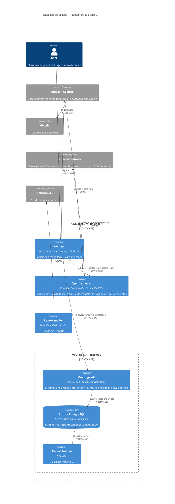

# SuccessfulSuccess — container diagram (C4, level 2)

Updated for Lab 6 (Paste an agenda). The two new paths are numbered:
**parse** (browser → agenda parser → Bedrock) and **save** (browser → API →
Aurora). The parser never writes; the save path is the one that existed before.

Not drawn, to keep the picture readable: the reports bucket, the SQS queue and
dead-letter queue, EventBridge Scheduler and the S3 gateway endpoint (Lab 5),
and the GitHub Actions deploy role (Lab 4).
